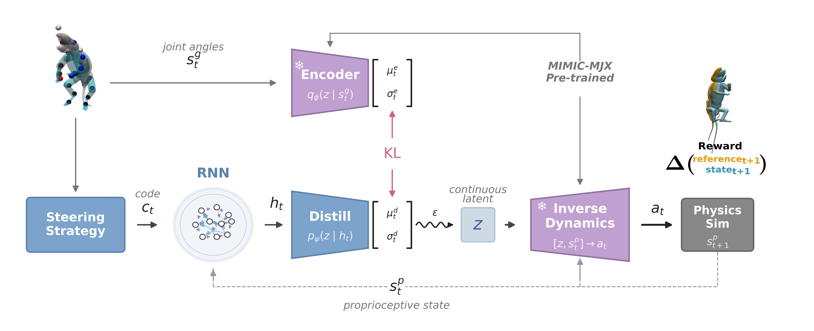
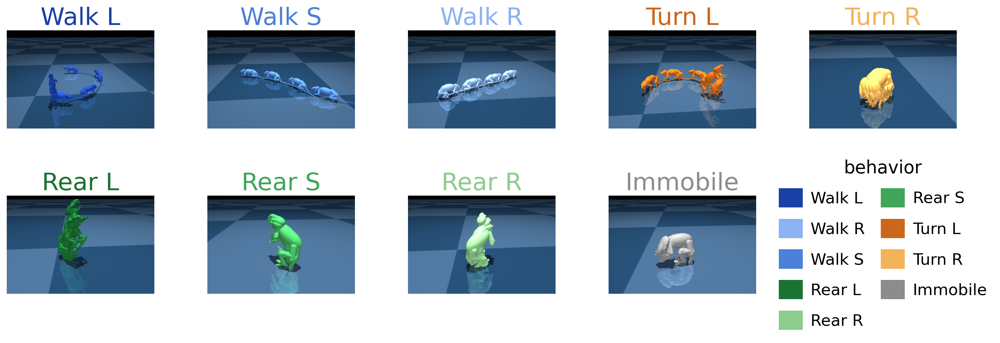

<div align="center">

# Code2Act

**Executing discrete behavioral vocabularies on a biomechanical rat**

Kaiwen Bian<sup>1,2</sup> &nbsp;·&nbsp;
Charles Y. Zhang<sup>3</sup> &nbsp;·&nbsp;
Yuanjia Yang<sup>1,2</sup> &nbsp;·&nbsp;
Aidan Sirbu<sup>4,5</sup> &nbsp;·&nbsp;
Eric J. Leonardis<sup>1,2</sup> &nbsp;·&nbsp;
Blake A. Richards<sup>4,5</sup> &nbsp;·&nbsp;
Bence P. Ölveczky<sup>3</sup> &nbsp;·&nbsp;
Talmo D. Pereira<sup>1,2</sup>

<sup>1</sup>Salk Institute for Biological Studies &nbsp;
<sup>2</sup>UC San Diego &nbsp;
<sup>3</sup>Harvard University &nbsp;
<sup>4</sup>Mila &nbsp;
<sup>5</sup>McGill University

Code for *Discrete Actions for Naturalistic Behavior in Embodied Biomechanical
Animal Models*<br>
NeurIPS 2026 Workshop on Neuro-Symbolic Embodied Intelligence (NEmo), oral

[](https://kbian.org/Code2Act-website/)

[](https://mimic-mjx.talmolab.org/)
[](LICENSE)
[](https://www.python.org/)
<!-- Add a Paper badge (OpenReview / arXiv) and link the Venue badge to the workshop site once public. -->

</div>

<p align="center">
  
</p>

<p align="center"><em>
<b>The Code2Act pipeline.</b> A steering strategy assigns each reference frame a
discrete code. A GRU reads the code context and proprioception, and a
distillation head maps its state to a motor intention, which the pretrained
MIMIC-MJX inverse-dynamics decoder turns into torques. The reference goal
reaches only the frozen Stage-1 encoder, which supplies a stop-gradient KL
target and never enters the action path.
</em></p>

## Abstract

Embodied symbolic systems depend on a discrete vocabulary that compresses
continuous motion into named actions, which make planning and annotation
tractable. Many such vocabularies exist, from unsupervised segmentation to hand
annotation, but they only describe motion, and making a body perform one of
their symbols requires a hand-engineered controller or a policy trained for that
symbol. We present **Code2Act**, which turns any discrete vocabulary into motor
commands for a 38 actuator biomechanical rat. One recurrent controller reads
only the symbol stream and proprioception, predicts the motor latent that a
frozen pretrained imitation model would supply, and decodes through that model's
inverse-dynamics module. A single training run then covers an entire vocabulary
with no per-symbol reward and no per-symbol training. We drove one controller
from three vocabularies of different provenance and size. An independent
labeler can recover each steering symbol from the motion it produced, across
arbitrary initial poses and external velocity impulses. Symbols are executed by
the body and realized as distinct motion, and novel combinations of symbol pairs
can produce within-distribution motion patterns.

## Method

Code2Act is built in three stages, each run as a separate process.

1. **Pretrained motor representation (Stage 1).** The MIMIC-MJX imitation
   policy is an encoder–decoder VAE. Its encoder maps the reference goal and
   proprioception to a 16-d latent intention; its decoder is an
   inverse-dynamics module that maps the intention and proprioception to the
   38 actuator torques of the rat.
2. **Steering strategy (Stage 2).** Any map that assigns each reference frame a
   discrete code. It is fit or written before training and frozen; the
   controller sees only the integer stream.
3. **Symbol-to-action interface (Stage 3).** A 4-layer GRU reads the
   embeddings of the next *N* = 5 codes together with proprioception. A head
   predicts a Gaussian over the intention, which is regressed onto the frozen
   encoder by a per-step KL, sampled, and decoded to torques by the Stage-1
   decoder. Training is PPO on the MIMIC-MJX motion-tracking reward plus the
   distillation KL.

We drive the same interface with three steering strategies that differ in
provenance and vocabulary size:

| Strategy | Source | *K* |
|---|---|---|
| **KPMS** | Unsupervised Keypoint-MoSeq syllables (AR-HMM) | 100 |
| **KVAE** | Kinematics VAE latents clustered with *K*-means | 25 |
| **MLB** | Manually labeled behaviors: {Walk, Rear, Turn, Immobile} × {Left, Straight, Right} | 9 |

<p align="center">
  
</p>
<p align="center"><em>The nine MLB codes, each held constant and rendered as a
motion trail.</em></p>

## Results

**Symbols steer realistic behavior.** Kernel inception distance (KID, lower is
better) between code-driven rollouts and the expert MIMIC-MJX policy, mean ± std
over three feature-extractor seeds. Every structured code stream lands far below
uniformly random codes.

| Strategy | Original | Transition matrix | Mamba | GPT | Random |
|---|---|---|---|---|---|
| KPMS (*K*=100) | 0.251 ± 0.007 | 0.378 ± 0.012 | 0.298 ± 0.014 | 0.268 ± 0.014 | 0.664 ± 0.024 |
| KVAE (*K*=25) | 0.247 ± 0.031 | 0.266 ± 0.022 | 0.292 ± 0.026 | 0.244 ± 0.015 | 0.998 ± 0.099 |
| MLB (*K*=9) | 0.162 ± 0.027 | 0.198 ± 0.036 | 0.246 ± 0.020 | 0.205 ± 0.037 | 0.729 ± 0.073 |

- **The interface reports which symbols are realizable.** Executed on the body,
  the 9 MLB symbols collapse onto about 5 distinguishable behaviors, and
  Keypoint-MoSeq usage concentrates on about 7 of its 100 syllables.
- **Held symbols are recovered from arbitrary starts.** Holding each MLB symbol
  from 60 initial poses, an independent kinematic labeler recovers the
  commanded symbol in 48% of rollouts and its behavior in 69% (chance: 11% and
  25%).
- **Held symbols recover from perturbation.** Five seconds after a velocity
  impulse, 85% (MLB), 92% (KPMS) and 74% (KVAE) of the induced displacement has
  decayed.
- **Unseen symbol pairs stay within the distribution of rat motion.** The 30 MLB
  pairs that never occur in the corpus reach a KID of 0.418 ± 0.045, against
  0.204 ± 0.023 for corpus sequences and 0.735 ± 0.083 for random codes.

See the paper for the full analyses (DSA code dynamics, round-trip
decompositions, perturbation protocol, kinematic signatures, and code atlases).

## Installation

Code2Act requires Python 3.11 or 3.12, a CUDA 12 GPU, and EGL for headless
rendering. It builds on [`track-mjx`](https://github.com/talmolab/track-mjx)
(branch `kevin/kpms-decoder`), cloned as a sibling directory:

```bash
git clone https://github.com/talmolab/code2act.git && cd code2act
git clone -b kevin/kpms-decoder https://github.com/talmolab/track-mjx.git
uv venv && source .venv/bin/activate
(cd track-mjx && uv pip install -e ".[cuda12]")
uv pip install "keypoint-moseq[cuda]" "jax-moseq[cuda]"
uv pip install -e .
```

The full setup (analysis extras for DSA, the PyTorch/CUDA caveats, and data
download) is in [`docs/installation.md`](docs/installation.md).

**Data.** The rat reference clips (`rodent_reference_clips.h5`) come from the
MIMIC-MJX release on Hugging Face
([`talmolab/MIMIC-MJX`](https://huggingface.co/talmolab/MIMIC-MJX)) and go in
`data/rodent/`. The per-frame behavior labels used by MLB
(`data/rodent/rodent_labels.csv`) come from
[TopoMimic-annotation](https://github.com/KevinBian107/TopoMimic-annotation).

## Usage

Keypoint-MoSeq enables 64-bit JAX irreversibly, so code generation and
controller training must run in separate processes. Commands are run from the
repository root.

**Stage 1: pretrained imitation VAE.**

```bash
python -m c2a.train_mimic_encoder
```

**Stage 2: steering strategies.** Each writes a `best_codes.npz` carrying its
own provenance (*K*, model type, hyperparameters).

```bash
# KPMS: Keypoint-MoSeq sweep (K=100), then export the selected model's codes.
python -m c2a.codegen.run_sweep --config c2a/configs/kpms_sweep_k100.yaml
python -m c2a.codegen.kpms.generate_codes \
    --sweep-results outputs/tokenizer/kpms_sweep/sweep_results.json \
    --balanced-split data/rodent/rodent_balanced_splits.json \
    --output outputs/tokenizer/kpms_sweep/s100_k1e+02_l10_arhmm/seed4/best_codes.npz

# KVAE: train the kinematics VAE, then cluster its latents into K=25 codes.
python -m c2a.codegen.kinematics_vae.vae.train loss_weights.kl=0.001 \
    train.ckpt_dir=outputs/tokenizer/trained_kinematics_vae_ckpts/vae_sweep/kl_0p001
python -m c2a.codegen.kinematics_vae.vae.tokenize --num-codes 25 \
    --ckpt-dir outputs/tokenizer/trained_kinematics_vae_ckpts/vae_sweep/kl_0p001/step_0030000 \
    --output outputs/tokenizer/trained_kinematics_vae_ckpts/vae_sweep/kl_0p001/tokenize_k25/best_codes.npz

# MLB: the hand-specified 9-code vocabulary.
python -m c2a.codegen.mlb_segmenter \
    --output outputs/tokenizer/mlb_v1/best_codes.npz --deadband 0.10
```

The KPMS tokenizer in the paper is fit with Keypoint-MoSeq's
`fix_heading=True`; a `fix_heading=False` variant is provided in
`c2a/configs/kpms_sweep_k100_fix_heading_false.yaml` (see the note in
`c2a/codegen/kpms/fit_kpms.py`).

**Stage 3: the symbol-to-action controller.** Configuration is
[Hydra](https://hydra.cc); any key can be overridden on the command line
(reference: [`docs/moseq_decoder_config.md`](docs/moseq_decoder_config.md)).

```bash
# KPMS
python -m c2a.train_moseq_decoder \
    kpms_config.code_source=kpms_raw \
    kpms_config.codes_path=outputs/tokenizer/kpms_sweep/s100_k1e+02_l10_arhmm/seed4/best_codes.npz

# MLB
python -m c2a.train_moseq_decoder --config-name=moseq_decoder_mlb
```

The exact per-strategy launch settings used for the paper's controllers,
including KVAE, are in
[`bash_scripts/training/`](bash_scripts/training/) (`run_train_kpms.sh`,
`run_train_kvae.sh`, `run_train_mlb.sh`). For a quick smoke test without any
tokenizer, set `kpms_config.codes_path=null` to train on random codes.

**Analyses.** Each experiment reads trained checkpoints and has its own Hydra
config next to the script; commands are in
[`docs/experiments.md`](docs/experiments.md).

| Paper result | Script |
|---|---|
| Distributional fidelity (KID, Table 1) | `c2a/experiments/fidelity/run_inception_distance.py` |
| Learned code priors (GPT, Mamba) | `c2a/ar_codegen/`, `c2a/experiments/tokenizer/run_code_generation.py` |
| Code dynamics (DSA) | `c2a/experiments/code_grid/run_code_grid_rollouts.py`, `run_code_grid_dynamics.py` |
| Code distinctness (NMI, effective code count) | `c2a/experiments/tokenizer/run_code_distinctness.py` |
| Round trip | `c2a/experiments/ic_contraction/run_code_roundtrip.py` |
| Perturbation recovery | `c2a/experiments/perturbation/run_perturbation_recovery.py` |
| Unobserved symbol pairs | `c2a/experiments/behavior/run_impossible_transitions.py`, `c2a/experiments/fidelity/run_transition_kid.py` |
| Gait spectra | `c2a/experiments/fidelity/run_gait_dynamics.py` |
| Kinematic signatures, code atlases | `c2a/figures/` |

## Repository layout

```
c2a/
├── train_mimic_encoder.py     Stage 1: MIMIC-MJX imitation VAE
├── codegen/                   Stage 2: KPMS, kinematics-VAE, and MLB code sources
├── train_moseq_decoder.py     Stage 3: Hydra entry point for the controller
├── moseq_decoder_network.py   GRU controller, distillation head, pretrained decoder
├── moseq_losses.py            PPO losses and the distillation KL
├── moseq_ppo.py               PPO training loop (adapts track-mjx)
├── moseq_env_wrapper.py       Imitation environment with per-frame code injection
├── ar_codegen/                Autoregressive code priors (GPT, Mamba)
├── experiments/               Analyses behind the paper's results
├── figures/                   Figure rendering
├── configs/                   Hydra configs
└── tests/                     Unit tests (pytest c2a/tests)
```

The full tree, and where every output and checkpoint is written, is in
[`docs/codebase_structure.md`](docs/codebase_structure.md).

## Citation

```bibtex
@inproceedings{bian2026code2act,
  title     = {Discrete Actions for Naturalistic Behavior in Embodied Biomechanical Animal Models},
  author    = {Bian, Kaiwen and Zhang, Charles Y. and Yang, Yuanjia and Sirbu, Aidan and
               Leonardis, Eric J. and Richards, Blake A. and {\"O}lveczky, Bence P. and
               Pereira, Talmo D.},
  booktitle = {NeurIPS 2026 Workshop on Neuro-Symbolic Embodied Intelligence (NEmo)},
  year      = {2026}
}
```

## Acknowledgements

Code2Act builds on [MIMIC-MJX](https://mimic-mjx.talmolab.org/) and
[`track-mjx`](https://github.com/talmolab/track-mjx) for the biomechanical rat
and imitation pipeline, [Keypoint-MoSeq](https://keypoint-moseq.readthedocs.io/)
for behavioral syllables, and [MuJoCo](https://mujoco.org/) /
[Brax](https://github.com/google/brax) for simulation and training.

## License

Released under the BSD 3-Clause License; see [`LICENSE`](LICENSE).
